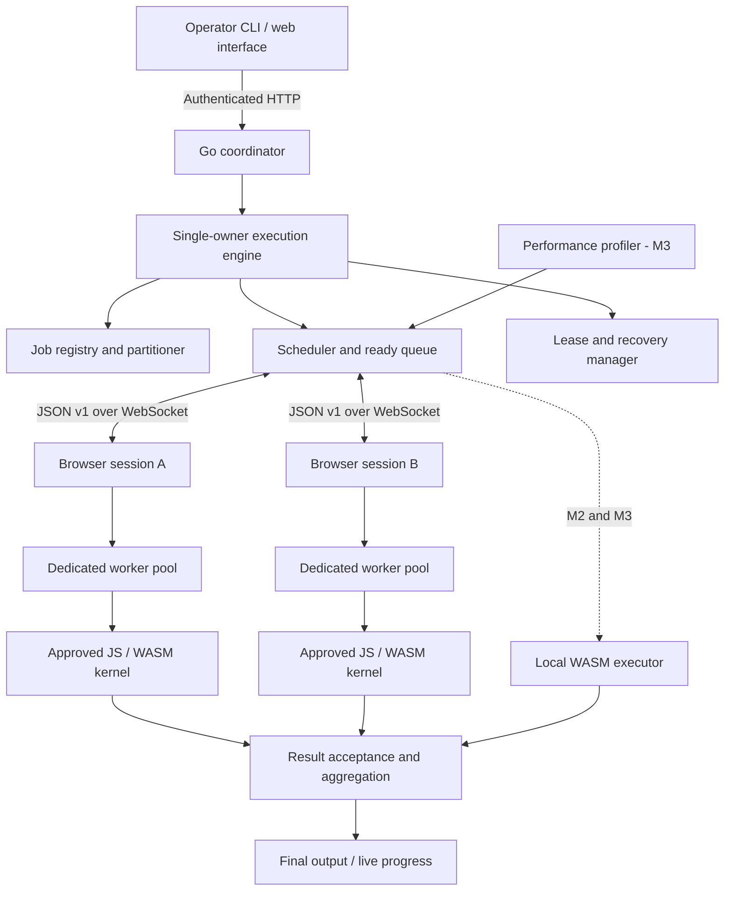
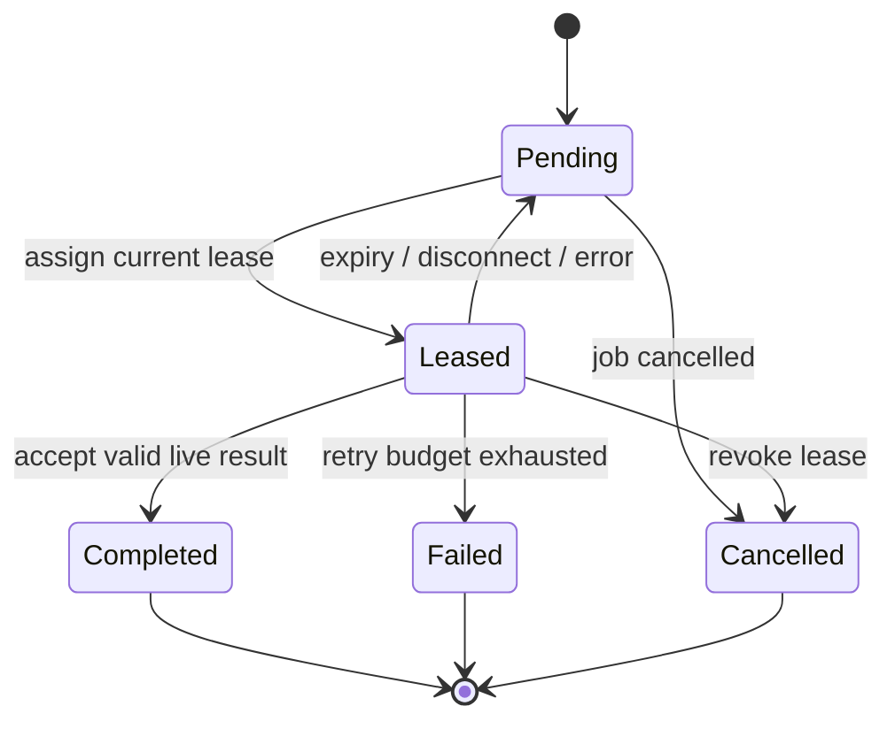
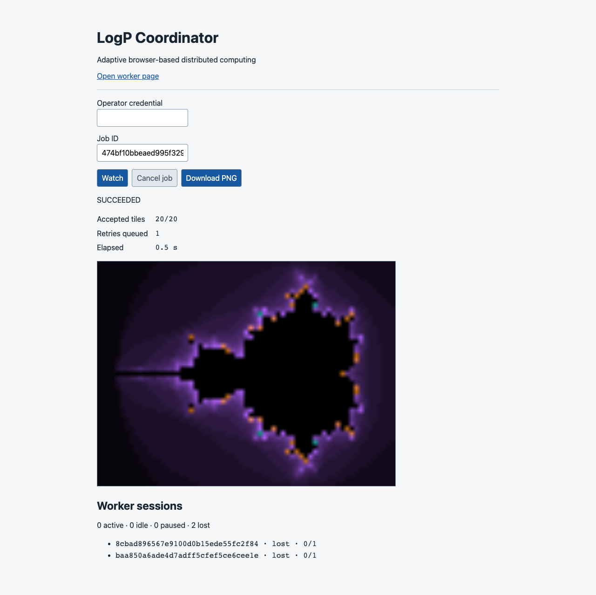

# LogP

**Adaptive browser-based distributed computing.**

*Every browser is a potential compute node.*

> **Status: Milestone 1 prototype.** The Go coordinator distributes Mandelbrot tiles to consenting browser sessions and assembles their results into a PNG. LogP is a provisional name. The planned v0.1 release includes later milestones, and performance benchmarking is pending.

## Overview

LogP is a self-hosted distributed computing prototype that lets consenting devices join a temporary compute cluster through a browser. An operator starts a lightweight Go coordinator, shares its worker page with trusted participants, submits a partitionable workload, and receives the assembled result.

Workers require no separately installed agent, container runtime or SSH setup. They execute approved CPU-bound tasks in dedicated browser workers. The coordinator tracks availability, assigns independent work units, handles interrupted execution and combines completed results.

The central research question is not simply whether computation can run in browsers. It is **when distributing computation is worth the cost**. A small job may complete faster locally than across several devices. A larger job may benefit from additional compute capacity, provided communication and scheduling overhead do not dominate. LogP aims to make this choice dynamically and evaluate it experimentally.

## Why LogP?

The working name is inspired by **LogP**, the parallel computation model introduced by David Culler and colleagues in *LogP: Towards a Realistic Model of Parallel Computation* (ACM PPoPP, 1993). Its parameters describe communication latency (**L**), processor overhead (**o**), the gap between consecutive message sends or receives (**g**), and the number of processors (**P**).

These ideas motivate our central question: when does additional computing capacity justify the cost of communication? The proposed runtime's scheduling model also accounts for heterogeneous worker speeds, queueing, payload sizes and module loading. It is inspired by LogP, not a formal implementation of the original mathematical model. The project name is provisional and does not imply affiliation with the authors.

## Motivation

Personal computers often have spare compute capacity, but pooling it typically requires installing software and configuring a shared environment. Browsers provide a widely available execution environment with worker threads and portable WebAssembly modules. At the same time, browsers are volatile workers: performance differs across devices, tabs can freeze or close, networks fluctuate, and a participant can leave at any moment.

LogP explores a narrow alternative for short-lived, trusted clusters. It is not a replacement for cloud computing, a dedicated HPC cluster, or a general-purpose distributed operating system. It is intended for independent, compute-heavy tasks with relatively small inputs and outputs.

## Intended applications

| Domain | Example workload | Scope |
|---|---|---|
| Scientific computing | Parameter sweeps, Monte Carlo simulations | Monte Carlo planned for v0.1 |
| Graphics | Tile-based fractal or image rendering | Mandelbrot is the first milestone |
| Media processing | Independent image transformations | Future candidate |
| Education | Parallel computing labs on existing devices | Initial deployment context |
| Data analysis | Independent numerical partitions | Future candidate |
| ML infrastructure | Independent small-model CPU inference | Exploratory, not part of v0.1 |

Suitable workloads can be partitioned without frequent inter-task communication, are deterministic or reproducibly seeded, and can be safely retried. Sensitive inputs, tightly coupled simulations and arbitrary stateful applications are outside the first release.

## Design principles

- **Zero-install participation:** a worker joins through a browser link; the operator runs one coordinator executable.
- **Explicit consent:** no computation or performance calibration before Join. Participants control concurrency and session duration and can stop immediately.
- **Elastic participation:** browser sessions can join and leave during a job; abandoned work becomes available again.
- **Correctness before speed:** server-owned leases, bounded retries and one accepted output per logical task in a coordinator lifetime.
- **Cost-aware execution:** compare local and hybrid execution instead of distributing every job indiscriminately.
- **Portable computation:** approved WebAssembly kernels run on both browser and coordinator-local runtimes in later milestones.
- **Small operational footprint:** no external database, message broker, Kubernetes or worker installation required for the planned first release.
- **Evidence over claims:** reproducible tests and benchmark data determine whether the proposed scheduling policy is useful.

## Architecture



The diagram represents the target design. M1 uses fixed JavaScript kernels and pull-based scheduling; WASM and adaptive placement are later milestones.

| Component | Responsibility |
|---|---|
| Coordinator | HTTP API, browser assets, job admission, worker session management |
| Partitioner | Convert input into deterministic, independently executable tasks |
| Scheduler | Match available worker slots to ready tasks; later estimate local/remote cost |
| Transport | Authenticated, bounded WebSocket messages, heartbeats, backpressure |
| Browser runtime | Dedicated Worker pool, explicit resource controls, deadlines, cancellation |
| Recovery manager | Track task leases, detect expired or disconnected workers, requeue safely |
| Aggregator | Validate task identity and result shape, accept once, reconstruct output |
| Profiler (M3) | Estimate per-kernel performance, communication cost and module loading overhead |

The Go coordinator uses a single goroutine to own mutable scheduling state. Network readers and writers communicate with this engine through bounded commands and events. Expensive computation and socket I/O must not block the state loop. This provides a straightforward consistency model without introducing distributed consensus. The coordinator remains a single failure domain.

## Execution lifecycle

1. Start the coordinator on the operator's machine and obtain separate operator and worker credentials.
2. Open the worker page on trusted devices. Choose resource limits and explicitly join.
3. Submit a supported job. The partitioner creates deterministic work units and places them in a bounded queue.
4. Workers announce their available slots. The scheduler issues tasks with a unique lease and deadline.
5. Dedicated Workers execute the approved kernel and return their result to the coordinator.
6. The coordinator checks the live lease, worker session, task identity and result structure before committing the output.
7. If a worker disconnects, pauses or exceeds its lease, unfinished tasks are retried within the job's attempt and time limits.
8. Accepted outputs are assembled into the final artifact and reflected in the operator interface.



Execution attempts can occur more than once. Result acceptance is at most once per logical task within the lifetime of the coordinator. This is not exactly-once execution and does not survive a coordinator restart. Kernels must be pure and safe to retry. Structural result validation cannot establish that an untrusted worker performed the computation correctly.

## Communication protocol

M1 uses versioned JSON text frames over WebSockets. The HTTP operator API is separate from the worker transport. Each worker session has a server-issued identity; each assignment has an independent lease ID.

```json
{
  "v": 1,
  "type": "ready",
  "request_id": "example-request",
  "payload": { "available_slots": 2 }
}
```

| Message | Purpose |
|---|---|
| `hello`, `welcome` | Authenticate and negotiate worker capacity and time limits |
| `ready`, `assign` | Announce available slots and issue work |
| `heartbeat` | Monitor session liveness; does not renew a task lease |
| `result`, `result_ack` | Submit and acknowledge accepted, stale or invalid output |
| `task_error`, `cancel` | Report failure or revoke an assignment |
| `pause`, `resume`, `leave` | Control participation explicitly |
| `error` | Report bounded protocol diagnostics |

The protocol rejects expired, duplicate and wrong-session results. Message sizes, worker slots, queues, retained results and retries are bounded. The proposed defaults and exact payload contracts are defined in [SPEC.md](SPEC.md).

## Scheduling research

### M1: availability-driven execution

A pull scheduler assigns pending tasks to connected workers that declare free slots. It provides a simple baseline and naturally accommodates variable worker completion rates. Each assignment is leased and may be reissued when it expires. No adaptive performance claim is made for this stage.

### M2: portable kernels

An approved WebAssembly module is compiled once and executed through the browser WebAssembly API and the local Go runtime (wazero). Both sides should use the same module bytes, explicit ABI and version. A content hash identifies the module for caching, not arbitrary publisher trust. Dedicated Workers provide cancellation boundaries; the local runtime uses context cancellation and memory limits.

### M3: adaptive placement and partitioning

For a candidate worker `i`, the initial cost model is:

```text
T_i = Q_i + L_i + D_i / B_i + W / R_i + M_i
```

| Term | Interpretation |
|---|---|
| `Q_i` | Estimated queue/slot waiting time |
| `L_i` | Fixed communication and assignment overhead |
| `D_i / B_i` | Estimated input/output transfer time |
| `W / R_i` | Work estimate divided by measured per-kernel throughput |
| `M_i` | Module loading cost on a cache miss |

The scheduler will estimate these quantities from actual measurements after consent, using bounded calibration and moving averages. Network cost must not be counted twice. If timing components cannot be isolated, a fitted combined overhead is preferable to false precision.

It compares predicted **whole-job completion time** under local-only and hybrid allocations, including partitioning and aggregation overhead. The initial policy favors local execution unless the predicted hybrid benefit exceeds a configurable margin (proposed default: 10%). The scheduler groups fixed microtiles into batches based on observed throughput; faster workers can receive larger batches, slower workers smaller ones. In-flight microtiles are not split. Every scheduling decision should be inspectable.

This is a proposed algorithm, not a proven innovation. Offloading, heterogeneous scheduling and dynamic partitioning are established research topics. The experiment is whether this particular cost model and implementation help in temporary, small browser clusters.

## Flagship workload: Mandelbrot rendering

Mandelbrot rendering offers a deterministic parallel workload with a visual correctness check. Each tile covers a rectangular region of the image. A worker computes escape iteration counts using the same coordinate mapping and iteration limit as the reference implementation. Results are returned as little-endian 16-bit iteration counts in row-major order. The coordinator validates bounds and assembles the image using a deterministic palette.

The demonstration and its planned extensions:

- Submit a rendering job and watch accepted tiles appear on a live canvas.
- Join another consenting device and observe actual task assignments and worker throughput.
- Disconnect a worker with unfinished tasks; observe recovery and reassignment.
- Compare the final image with a reference implementation.
- In M3, vary the workload or network conditions to show why local execution can outperform distribution for small jobs.

The operator view polls the coordinator for real accepted tiles, retries, elapsed time and worker status. The live canvas and PNG use the same palette. Pixels reaching the iteration cap are black. Escaped pixels use RGB values `(9n, 5n, 13n) mod 256` for iteration count `n`.

A second planned workload, seeded Monte Carlo simulation, will distribute deterministic sample index ranges and combine integer counts. This validates the execution abstraction beyond fractal rendering. Batch image transformation is a subsequent practical workload candidate.

The completed canvas and server-reported counts below come from the Chromium integration test.



## Technology stack

| Layer | Selected technology |
|---|---|
| Coordinator, CLI, scheduler | Go, standard library, goroutines and channels |
| Worker transport | `github.com/coder/websocket` (pinned dependency) |
| Browser runtime (M1) | HTML, CSS, JavaScript ES modules, Dedicated Workers |
| Portable kernels (M2) | Rust or C compiled to WebAssembly; explicit bounded ABI |
| Local execution (M2) | wazero |
| Visualization | Canvas; embedded static assets |
| Testing | Go tests, race detector, Playwright for browser integration |
| Initial state | In-memory, bounded |

The primary language is Go. The browser uses native web APIs. TypeScript may be introduced if justified by runtime complexity. The first milestone intentionally avoids a frontend framework or build system.

## Repository structure and planned additions

```text
cmd/coordinator/          CLI entry point
internal/server/       HTTP API, auth, WebSocket transport
internal/engine/       scheduler, state machine, registry, leases
internal/protocol/     typed envelopes and validation
internal/workload/     partitioners, reference kernels, aggregation
internal/web/          embedded pages, worker scripts
internal/identity/     display identity and CLI label
browser/               development-only Chromium integration tests
examples/              sample job inputs and walkthroughs
benchmarks/            methodology, scripts, measured results
research/              related work and experiments
docs/                  architecture decisions and limitations
README.md
SPEC.md
```

The benchmark and research directories are planned for later milestones.

## Getting started

The source entry point and protocol identifiers are intentionally independent of the product name. The executable can be named `logp` for now (`logp.exe` on Windows).

Use Go 1.25 or newer and a browser with Dedicated Workers and WebSockets. The coordinator embeds all runtime web assets. Start it from an interactive terminal to see the generated credentials, or provide both credential environment variables for unattended runs.

```sh
go run ./cmd/coordinator serve
# Default: http://127.0.0.1:8080
```

In a second terminal, load the displayed operator credential into the CLI environment without placing it in shell history. This example works in Bash and Zsh.

```sh
printf 'Operator credential: '
IFS= read -rs BROWSER_COMPUTE_OPERATOR_TOKEN
printf '\n'
export BROWSER_COMPUTE_OPERATOR_TOKEN
go run ./cmd/coordinator submit --file examples/mandelbrot.json
```

Copy the returned `id` into `JOB_ID`. Before joining a worker, `status` should show `QUEUED` and zero accepted tiles. Open the operator view at `http://127.0.0.1:8080/`, enter the operator credential and job ID, then choose **Watch**. Open `http://127.0.0.1:8080/worker` in a separate window, enter the worker credential, choose a slot count, and select **Join**. Keep the worker page visible. The operator canvas fills as tiles arrive.

```sh
JOB_ID='paste-the-returned-job-id-here'
go run ./cmd/coordinator status --job "$JOB_ID"
# After SUCCEEDED, use a path that does not already exist.
go run ./cmd/coordinator result --job "$JOB_ID" --out output.png
# To cancel a separate queued or running job:
go run ./cmd/coordinator cancel --job "$JOB_ID"
```

For a second laptop on a trusted private LAN, stop the loopback instance and start the coordinator with:

```sh
go run ./cmd/coordinator serve --listen 0.0.0.0:8080
```

Open `http://<coordinator-LAN-IP>:8080/worker` on the second laptop. Enter the newly issued worker credential and select **Join**. Keep both worker pages visible while submitting the example again from the coordinator host. The dashboard lists both sessions. For a longer recovery exercise, submit a larger fixture after the first job ends.

```sh
sed -e 's/"width":1024/"width":2048/' -e 's/"height":768/"height":2048/' \
    -e 's/"max_iter":512/"max_iter":2048/' -e 's/"tile_size":32/"tile_size":64/' \
    examples/mandelbrot.json > /tmp/mandelbrot-recovery.json
go run ./cmd/coordinator submit --file /tmp/mandelbrot-recovery.json
```

Watch the new job ID and close one worker while its active tile count is positive. The dashboard should show the lost session and a retry while the other worker continues. Test **Pause**, **Resume** and **Stop** on the worker page. Switching away from a worker tab should pause it until explicit Resume. Plain HTTP exposes traffic on the LAN. Use non-sensitive inputs and keep the coordinator off the public internet.

## Safety, privacy and resource limits

- No hidden background computation, anonymous public workers, cryptomining or automatic participation.
- No arbitrary uploaded scripts or WASM in v0.1. Only known, versioned and approved kernels.
- Default one worker slot, maximum four per session, capped by reported capability; default 15-minute session. Participant controls may pause, resume or stop work. Visibility loss pauses computation by default, with explicit resume.
- Separate operator and worker credentials, strict same-origin WebSocket checks, no permissive CORS, no credential URLs or persistent browser storage. Loopback binding by default.
- Bound task duration, retry attempts, job size, worker count, queues and retained data. Reject excessive requests rather than allocate indefinitely.
- Workers can see the inputs they receive. Trust the participants and avoid confidential data. Structural checks are not protection from fabricated mathematical outputs.
- Browser freezing, power management, thermal throttling and network loss can interrupt work; leases let the coordinator reject stale results and reassign tasks. No guarantee of mobile performance.
- In-memory coordination means a coordinator crash loses current jobs. Durable recovery, coordinator redundancy and public security hardening are separate future work.

See [SPEC.md](SPEC.md) for the detailed trust model, protocol limits, error handling and cancellation semantics.

## Evaluation plan

The aim is to demonstrate real usefulness, not merely successful distribution. Compare the following under equivalent kernels, workload and declared concurrency:

| Baseline | Question |
|---|---|
| Optimized local multithreading | Is distributed execution worthwhile at all? |
| Distributed round-robin | Does a simple static policy suffice? |
| Distributed fixed-size pull | Does availability alone provide good balancing? |
| Adaptive hybrid scheduling | Does cost-aware placement and batch sizing improve outcomes? |

Test different worker counts, mixed device capabilities, workload sizes, computation-to-transfer ratios, cold and warm module caches, latency and worker loss. Record end-to-end latency, median and p95 completion time, spread, throughput, actual network bytes, worker busy time, retry counts, recovery time and scheduling overhead. Define speedup as local baseline duration divided by policy duration. Report hardware, browser versions, topology, repetitions (target at least ten per configuration when feasible), warm-up, raw results and failures. A browser-context test on a single host demonstrates the protocol, not multi-device speedup. Compare against an optimized local implementation using the same WASM module in M3.

**Current benchmark status:** no measurements. Negative results are valid research outcomes. The hypothesis is that the adaptive policy avoids overhead-bound offloading and helps some heterogeneous scenarios; it may not outperform simpler scheduling in every case.

### Testing gates

```sh
go test ./...
go test -race ./...
go vet ./...
go build -o logp ./cmd/coordinator
```

Run the browser suite after building the coordinator. Node.js and Playwright are development dependencies.

```sh
npm --prefix browser ci
(cd browser && npx playwright install chromium)
npm --prefix browser test
# Alternatively, use a locally installed Google Chrome.
BROWSER_CHANNEL=chrome npm --prefix browser test
```

The Go tests exercise lease expiry, stale and duplicate results, bounded retries, cancellation, resource caps, transport validation and PNG assembly. The Playwright suite uses two independent Chromium browser contexts and checks consent, real tile execution, disconnect recovery, the full iteration buffer, PNG pixels, the dashboard canvas and worker controls. The Go test, race, vet and build commands passed on macOS arm64 with Go 1.25.11. Both Playwright tests passed with Node.js 24.22.0 and Chrome 158.0.8127.37 on the same host. A separate physical-device LAN test is still pending. See [implementation notes](docs/decisions.md).

## Roadmap

| Milestone | Deliverable | Status |
|---|---|---|
| M1 — Foundation | Go coordinator, browser JS worker pool, fixed tiles, pull scheduling, leases, real Mandelbrot output and recovery | Prototype implemented |
| M2 — Portable execution | Approved WASM kernel, module caching, matching local executor | Planned |
| M3 — Adaptive scheduling | Worker profiling, cost-aware local/hybrid choice, dynamic batches, comparative experiments | Planned |
| M4 — Evaluation and release | Seeded Monte Carlo workload, raw benchmark data, documentation, installable release | Planned |

The v0.1 target includes all four milestones. WebRTC/P2P, decentralized coordination, GPU acceleration, arbitrary-code execution, public volunteer networks, financial incentives, distributed storage and general DAG orchestration are not part of this target. They require separate design and safety decisions.

## Related work and research foundations

LogP is an independent project proposal in an established research area. Browser-based volunteer computing, WebAssembly offloading and adaptive scheduling are not new. The purpose of this project is to investigate a focused implementation and publish reproducible evidence of its trade-offs, rather than claim to have invented browser computing.

| Research / system | Relevance |
|---|---|
| Culler et al., *LogP: Towards a Realistic Model of Parallel Computation*, ACM PPoPP 1993 | Foundational communication-cost model inspiring the working name and cost-aware research direction |
| [Pando: Personal Volunteer Computing in Browsers](https://arxiv.org/abs/1803.08426), Lavoie et al., ACM Middleware 2019 ([code](https://github.com/elavoie/pando-computing)) | Personal browser-based parallel computation, dynamic participation and workloads including image processing |
| [Wasimoff: Distributed Computation Offloading Using WebAssembly in the Browser](https://www.fdr.uni-hamburg.de/record/14052), University of Hamburg, 2024 ([code](https://github.com/wasimoff/wasimoff)) | Closest architectural precedent: portable task execution and heterogeneous browser resources |
| [Opportunistic Distributed Computation Offloading using WebAssembly](https://www.inf.uni-hamburg.de/en/inst/ab/dos/teaching/theses/abschlussarbeitenprofile/2023/ma-anton-semjonov.html), Anton Semjonov, University of Hamburg, 2023 | Thesis underlying Wasimoff; future-work questions on context-aware scheduling and dynamic offloading |
| [Kuack](https://github.com/kuack-io/kuack) | Kubernetes integration with browser-based WASM workers |
| [WASMHive](https://github.com/WASMHive/WASMHive-Runtime) | Browser MapReduce using WebAssembly and WebRTC |
| [SwarmCompute](https://github.com/itsoumya-d/swarmcompute) | Related Go and browser-based WASM compute mesh |

Our intended emphasis is the explicit choice between local and hybrid execution, measured in temporary trusted clusters with a small self-contained coordinator. This is a design distinction to investigate, not an exhaustive novelty finding or a verified performance advantage. No affiliation with the above research institutions is implied.

Technical references: [MDN Web Workers](https://developer.mozilla.org/en-US/docs/Web/API/Web_Workers_API), [Page Visibility API](https://developer.mozilla.org/en-US/docs/Web/API/Page_Visibility_API), [Chrome Page Lifecycle](https://developer.chrome.com/docs/web-platform/page-lifecycle-api), [wazero](https://wazero.io/), [coder/websocket](https://github.com/coder/websocket).

## Documentation and licence

[Technical specification](SPEC.md) defines the detailed architecture, protocol, state machine, workload contract, security model and test criteria. Implementation decisions and any changes to that contract should be documented as work progresses.

Apache-2.0 is the proposed licence, pending maintainer approval and inclusion of the licence text. The project is not yet released under that licence. Third-party dependencies and research remain subject to their respective licences and attribution requirements.
